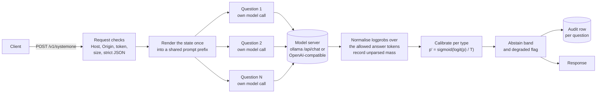

# decisionhead

[](https://github.com/dtinholt/decision-head/actions/workflows/ci.yml)
[](LICENSE)
[](pyproject.toml)

decisionhead is a small HTTP service that answers typed questions about a
case. You send a state (a document, a ledger, any text or JSON) and a set
of questions, each one yes/no, pick-one-of-several, or a rating on a
scale. You get back a probability for every answer, read directly from
the token probabilities of a language model you run yourself: any
OpenAI-compatible server or ollama model that returns logprobs. Each
question is asked in its own model call, probabilities can be calibrated
on your own labelled cases, and every decision is written to an audit log
with enough detail to verify it later. It is standard-library Python with
no runtime dependencies.

Contents: [Quickstart](#quickstart) ·
[Question types](#question-types) · [Modes](#modes) ·
[How it works](#how-it-works) · [The audit row](#the-audit-row) ·
[Configuration](#configuration) · [Security](#security) ·
[Benchmarks](#benchmarks) · [HTTP API](#http-api) ·
[Deployment](#deployment) · [Status and roadmap](#status-and-roadmap) ·
[Repository layout](#repository-layout) ·
[Citing](#citing) · [Licence](#licence)

## Quickstart

You need Python 3.11 or later and a model server that returns
per-token logprobs: ollama (native API) or an OpenAI-compatible server
such as vLLM. No model at hand? Every step works with `--dry`, a built-in
fake backend.

**1. Install.**

```
git clone https://github.com/dtinholt/decision-head
cd decision-head
pip install .
```

**2. Check that your model returns usable logprobs.** `qwen3.8:27b` is
the example model used throughout these docs; substitute any model your
server has loaded. This sends one trivial yes/no question straight to
the backend:

```
decisionhead probe --backend ollama --base http://127.0.0.1:11434 --model qwen3.8:27b
```

Look for `"healthy": true`. For vLLM use `--backend openai --base
http://127.0.0.1:8000 --model <served model name>` (the base URL has no
`/v1`).

**3. Start the service.**

```
decisionhead serve --backend ollama --base http://127.0.0.1:11434 --model qwen3.8:27b
```

or, with no model, `decisionhead serve --dry`, which prints:

```
decisionhead listening on http://127.0.0.1:8787 (backend=dry-fake, model=dry-fake-model, mode=fast, max_concurrency=1, cache_enabled=True)
```

That banner goes to stdout. The server's own log goes to stderr as one
JSON object per line (`request_start`, `request_end` and so on); those
lines are normal operation, not errors.

**4. Ask two questions** from another terminal:

```
curl -s http://127.0.0.1:8787/v1/systemone \
  -H 'Content-Type: application/json' \
  -d '{
    "model": "any",
    "state": "Supplier Acme Logistics BV sent a W-9 and an insurance certificate issued to Acme Logistics Inc.",
    "questions": {
      "names_match": {"type": "noul",
                      "instructions": "The insurance certificate names the same legal entity as the W-9."},
      "next_step":   {"type": "choice", "instructions": "What should happen next?",
                      "options": {"APPROVE": "onboard the supplier",
                                  "REQUEST_DOCS": "ask for a corrected certificate",
                                  "ESCALATE": "send to a human reviewer"}}
    }
  }' | python3 -m json.tool
```

This is the exact output from `decisionhead serve --dry`. The fake
backend's numbers are a hash of the question text, not a judgement; a
real model returns the same shape with its own probabilities and its own
model id.

```json
{
    "model": "dry-fake-model",
    "answers": {
        "names_match": {
            "type": "noul",
            "noul": 0.123998264892492,
            "unparsed_mass": 0.0,
            "no_family_match": false,
            "non_finite_logprob_count": 0,
            "degraded": false
        },
        "next_step": {
            "type": "choice",
            "choice": "ESCALATE",
            "probabilities": {
                "APPROVE": 0.16695843707815705,
                "REQUEST_DOCS": 0.16695843707815705,
                "ESCALATE": 0.6660831258436859
            },
            "confidence": 0.49912468876552885,
            "unparsed_mass": 0.0,
            "no_family_match": false,
            "non_finite_logprob_count": 0,
            "degraded": false
        }
    },
    "usage": {
        "input_tokens": null,
        "output_tokens": null
    },
    "mode": "fast",
    "low_confidence": false,
    "degraded": false
}
```

`noul` is the probability of Yes. `confidence` is the top probability
minus the runner-up. `unparsed_mass`, `no_family_match` and
`non_finite_logprob_count` say how much of the model's output the reading
could account for; `degraded: true` means there was no usable reading and
the value is `null` (see [Degraded answers](docs/http-api.md#degraded-answers)).
The path `/v1/systemone` and the required `model` field come from the
hosted typed-question API whose request shape this service follows.
`model` must be a non-empty string but is otherwise ignored: the server
always answers with the model it was started with and reports that id in
the response. A client written for the hosted API therefore works with
only a base-URL change.

`examples/quickstart.sh` does steps 3 and 4 in one command, and
`examples/python_client_example.py` does them from Python.

## Question types

| Type | You supply | You get back |
|---|---|---|
| `noul` (yes/no) | `instructions` phrased so Yes or No answers it | `noul`: probability of Yes |
| `choice` | `instructions` and 2 to 26 named `options` | `choice`, `probabilities` per option, `confidence` |
| `score` | `instructions` and 2 to 26 `levels`, lowest first | `score`, `probabilities` per level, `confidence` |

```json
{"type": "noul",   "instructions": "The certificate of insurance is dated within the last 12 months."}
{"type": "choice", "instructions": "What should happen next?",
                   "options": {"CONTINUE": "keep working the case", "REQUEST": "ask the supplier", "ESCALATE": "send to a person"}}
{"type": "score",  "instructions": "How urgent is this case?", "levels": ["low", "medium", "high"]}
```

The type names, including `noul` for yes/no, come from the hosted API
whose request shape this service follows. `options` may also be called
`criteria` or `levels`, and may be a list
of names instead of an object. A `score` is the winning level's name if
it is a number (`"1"`, `"2.5"`), otherwise its position in the list
(`high` above is `3.0`). Levels are never re-sorted.

## Modes

| Mode | How a question is answered | Cost per question | Use it when |
|---|---|---|---|
| `fast` (default) | One call at temperature 0 that generates a single token; the probability is read from that token's logprobs. | 1 generation of 1 token | The default. You want a probability that is the model's own belief, cheaply, and can calibrate it. |
| `deliberate` | `k` (default 8) sampled replies that reason briefly and end in a JSON answer; the probability is the vote share. | `k` generations of up to 256 tokens | The question needs a few steps of reasoning that a single token cannot carry. Vote shares are not calibrated; terminal "done" answers can be guarded (`docs/deliberate.md`). |
| `learned` | No LLM call. A small classifier trained offline on your own labelled decisions reads features of the state. | No model call | You have a few hundred labelled decisions from your own process and structured state. `choice` questions only (`docs/training.md`). |

Set the server's mode with `--mode`. A request may override it with a
top-level `"mode"` field unless the server runs with `--no-mode-override`
(recommended for `learned` servers, which have no LLM to fall back on).

## How it works



1. The state is rendered once into a system turn plus a user turn. Every
   question is appended to that same prefix as its own final turn and
   sent in its own model call, so no question sees another and a serving
   engine's prefix cache can reuse the shared part.
2. In fast mode the model generates one token. The answer is constrained
   to `Yes`/`No` or to option letters `A`, `B`, `C`, and the probability
   of each answer is its share of the logprob mass that fell on allowed
   tokens (case- and whitespace-insensitive). Mass that fell elsewhere is
   reported as `unparsed_mass`, not dropped.
3. If you loaded a calibration file, each type's temperature `T` is
   applied as `p' = sigmoid(logit(p) / T)` (elementwise and renormalised
   for `choice`/`score`).
4. An optional abstain band flags `noul` answers inside `[lo, hi]`; a
   reading with no allowed token at all is returned as degraded with a
   `null` value.
5. Each question's audit row is written before the response is sent.

`docs/design.md` has the full mechanism, why ollama's OpenAI-compatible
route is not used, and the limits of a single-token reading.

## The audit row

With `--audit audit.jsonl`, every answered question appends one line.
A real row from the `--dry` server (`next_step` of the request in
`docs/http-api.md`):

```json
{"request_hash": "a8ddec8ba9bbb60ffa5d0bb9dd50a1a9757d1b3a8e5d3dd976be4cd1d3a914e8",
 "question_id": "next_step", "model": "dry-fake-model", "backend": "FakeBackend",
 "calibrated": false, "latency_s": 1.0013580322265625e-05, "cache_hit": false,
 "unparsed_mass": 0.0, "no_family_match": false, "non_finite_logprob_count": 0, "degraded": false,
 "raw_distribution": {"APPROVE": 0.17431143392443454, "REQUEST_DOCS": 0.6513771321511309, "ESCALATE": 0.17431143392443454},
 "letters": {"APPROVE": "A", "REQUEST_DOCS": "B", "ESCALATE": "C"},
 "ts": "2026-10-06T22:22:40.610Z", "request_id": "81c16f5b89444043b381907858e7197c",
 "status": 200, "mode": "fast", "calibration_version": "",
 "answer": {"type": "choice", "choice": "REQUEST_DOCS", "probabilities": {"...": "as returned"}, "confidence": 0.47706569822669637, "...": "..."}}
```

* `request_id` equals the response's `X-Request-Id` header.
* `request_hash` is a SHA-256 of the state, the questions and the model.
  The log never stores the state itself; recomputing the hash from your
  own case record proves which inputs a row belongs to.
* `raw_distribution` is the reading before calibration, `answer` is what
  the client received, and `calibration_version` identifies the
  calibration file that turned one into the other.
* Requests that fail (`4xx`, `5xx`, timeouts) get one row each with their
  status and error code. If a row cannot be written, the client gets a
  `500` rather than an unaudited answer.

`docs/audit-log.md` documents every field and walks through
reconstructing and verifying a past decision.

## Configuration

Settings come from CLI flags, then `DECISIONHEAD_*` environment
variables, then a TOML file (`--config`, see `decisionhead.example.toml`),
then defaults. The ones most deployments touch:

| Setting | CLI flag | Default | Purpose |
|---|---|---|---|
| `backend` | `--backend` | `ollama` | `ollama` or `openai` (any OpenAI-compatible server) |
| `base_url` | `--base` | none | Model server root URL, without `/v1` |
| `model` | `--model` | none | Model id to call and report |
| `mode` | `--mode` | `fast` | `fast`, `deliberate` or `learned` |
| `calibration_path` | `--calibration` | none | `calibration.json` from `decisionhead calibrate` |
| `audit_path` | `--audit` | none | Audit log file |
| `bearer_token_env` | `--bearer-token-env` | none | **Name** of the variable holding the API token |
| `host` / `allowed_hosts` | `--host` / `--allowed-hosts` | `127.0.0.1` / none | Bind address; extra hostnames clients may use |
| `max_concurrency` | `--max-concurrency` | `1` | Backend calls in flight; `1` keeps logprobs reproducible |
| `request_timeout_s` | `--request-timeout-s` | `30` | Per-request budget; `504` after it |

Secrets are never accepted as values: the API key and bearer token are
read from environment variables whose names you configure. The full
reference, with every option, its environment variable, validation and
effect, is `docs/configuration.md`.

Calibrating on your own labelled cases:

```
decisionhead calibrate --labelled cases.jsonl --backend ollama \
    --base http://127.0.0.1:11434 --model qwen3.8:27b --out calibration.json
decisionhead serve ... --calibration calibration.json
```

It needs at least 50 labelled items per question type and reports Brier
score, ECE and a reliability table before and after (`docs/calibration.md`).

## Security

* Binds `127.0.0.1` by default. Any other bind needs `--allow-non-local-bind` **and** a bearer token, or it refuses to start.
* Every route it serves checks the `Host` header (`421` otherwise, which stops DNS rebinding); a POST with an `Origin` header is refused while CORS is off; the body must be `application/json`, size-capped, depth-checked and strict JSON.
* Backend calls refuse redirects and non-http(s) URLs and cap response size; a timed-out request abandons every backend call it has not started.
* No secret is accepted as a flag or written to a log, response, audit row or cache row; error responses carry fixed messages, never stack traces or backend text.
* It is **not** an authentication boundary or a multi-tenant service, it trusts the model server it points at, and `state` reaches the model verbatim (prompt injection can steer it). Put a gateway in front of anything shared.

Threat model and reporting: [SECURITY.md](SECURITY.md). Independent
reviews: [2026-09-23](docs/security-review-2026-09-23.md),
[2026-10-06](docs/security-review-2026-10-06.md) and its
[closures](docs/security-review-2026-10-06-closures.md).

## Benchmarks

These results come from registered experiments on **synthetic workflow
processes** (a supplier-onboarding process and an accounts-payable
exception process built the same way), not on production data. They are
reported in *The Open Decision Head: An Executive Briefing* (D. Tinholt,
23 September 2026); the numbers below are copied from it and nothing is
added. The metric is decision-class accuracy (share of checkpoints where
the chosen class of next step was correct); the hosted service is the
typed-question API this project's interface follows, reached through a
third-party router.

| Process, cases | Rule table | decisionhead | Hosted service |
|---|---|---|---|
| Onboarding, 800 held-out cases, first zero-shot head | 0.575 | **0.545** (below the rule table) | 0.540 |
| Onboarding, 800 fresh cases, retrained head | 0.566 | 0.728 | not run |
| Onboarding, 200-case harder set, retrained head | 0.565 | 0.739 | 0.536 |
| Accounts payable, two splits, open head | 0.648 / 0.638 | 0.650 / 0.659 (level with the rule table) | 0.636 / 0.622 |
| Accounts payable, two splits, learned mode | 0.648 / 0.638 | 0.522 / 0.558 trained on onboarding only; 0.663 / 0.671 after training on 100 labelled cases of the new process | n/a |

How the rows map to this package: the "first zero-shot head" is fast
mode with no task-specific training, and the "learned mode" row is
`mode: "learned"` trained with `python -m decisionhead.train`. The
"retrained head" rows come from a second experimental round that the
brief does not break down by mode, so do not expect a default install
to reproduce them; measure on your own labelled cases
(`docs/pilot.md`).

What the brief also reports, including the parts that do not favour this
project:

* The first zero-shot head lost to the hand-written rule table. The gap
  of -0.029 has an interval from +0.001 to -0.060, so it is
  inconclusive, and that head's calibration was poor (expected
  calibration error near 0.52 against a registered bar of 0.08).
* On the second process the open head only matched the rule table,
  and a learned head trained on the first process failed until it was
  retrained on about a hundred cases of the new one.
* The hosted service is faster. It answered a single question in
  0.35 s; fast mode's median response time under load on the project's
  own hardware was 3.1 s (p90 4.8 s).
* Repeat consistency depends on serving: with one call in flight the
  open head changed its answer on 0.05% of repeats (the hosted service's
  figure); with four calls in flight, 1.95% to 3.4%. That is why
  `max_concurrency` defaults to 1.

`decisionhead bench` measures latency, throughput and repeat consistency
against your own backend (`--dry` runs the same code with no hardware);
`docs/audit/README.md` lists the evidence artefacts and the command for
each.

## HTTP API

| Method and path | Purpose |
|---|---|
| `POST /v1/systemone` | Answer typed questions about a state |
| `GET /health` | Liveness, never touches the backend |
| `GET /ready` | Backend reachability, cached for 5 s |
| `GET /v1/models` | The real model id and the accepted alias |
| `GET /metrics` | Prometheus counters and latency histograms |
| `GET /openapi.json` | OpenAPI 3.0 document |

Errors are `{"error": {"code", "message"}}` with a status from a fixed
set (`400`, `401`, `403`, `413`, `415`, `421`, `429`, `500`, `502`,
`504`). The full reference, including every field in each mode and the
order of checks, is [docs/http-api.md](docs/http-api.md).

## Deployment

**From the command line**, next to an existing model server:

```
export DH_TOKEN="$(openssl rand -hex 32)"
decisionhead serve --backend ollama --base http://127.0.0.1:11434 --model qwen3.8:27b \
    --audit audit.jsonl --bearer-token-env DH_TOKEN
```

Clients then send `Authorization: Bearer $DH_TOKEN`. If the model server
is on another machine, use `https://` where you can; a plain `http://`
URL to a non-loopback host (for example `http://203.0.113.10:11434`)
works but logs a start-up warning, because the case state crosses the
network unencrypted.

**In a container.** The image binds `127.0.0.1` inside the container by
default, which a published port cannot reach. To publish it, open the
bind and set a token; the server refuses a non-loopback bind without
one:

```
docker build -t decisionhead .
export DECISIONHEAD_BEARER_TOKEN="$(openssl rand -hex 32)"
docker run --rm -p 127.0.0.1:8787:8787 \
    -e DECISIONHEAD_BACKEND=ollama \
    -e DECISIONHEAD_BASE_URL=http://host.docker.internal:11434 \
    -e DECISIONHEAD_MODEL=qwen3.8:27b \
    -e DECISIONHEAD_HOST=0.0.0.0 -e DECISIONHEAD_ALLOW_NON_LOCAL_BIND=true \
    -e DECISIONHEAD_BEARER_TOKEN_ENV=DECISIONHEAD_BEARER_TOKEN -e DECISIONHEAD_BEARER_TOKEN \
    decisionhead
```

The image runs as a non-root user, has no build stage, and has a
`HEALTHCHECK` on `/health`.

**With compose.** Create `.env` with the token first (it is gitignored):

```
echo "DECISIONHEAD_BEARER_TOKEN=$(openssl rand -hex 32)" > .env
docker compose up --build                            # decisionhead plus its own ollama
docker compose -f examples/compose.yaml up --build   # decisionhead only, model server on the host
```

Both publish decisionhead on host loopback only (`127.0.0.1:8787`). The
bundled ollama is not published at all.

To serve clients on other machines, publish the port on a reachable
interface (behind TLS) **and** list the name or IP address those clients
use in `DECISIONHEAD_ALLOWED_HOSTS`, for example
`DECISIONHEAD_ALLOWED_HOSTS=dh.internal,203.0.113.20`. Inside a
container the server only recognises the loopback names, so without
that setting every remote request gets `421 misdirected_request`.

**Bind and token rules, in short:**

* `127.0.0.1`, `localhost` or `::1`: starts, token optional.
* Anything else: needs `--allow-non-local-bind` and a non-empty token
  (or `--insecure-no-auth`, which logs a WARNING).
* Clients that reach the server by a DNS name need that name in
  `--allowed-hosts`; any other `Host` is refused with `421`.
* If `--bearer-token-env` names a variable that is unset or empty, the
  server refuses to start, on every bind address.

## Status and roadmap

Version 0.1.0, pre-1.0: the HTTP API may still change, and every change
is recorded in [CHANGELOG.md](CHANGELOG.md). The test suite (597 passing,
1 skipped unless external benchmark data is configured) runs with no
network and no model.

Known limitations:

* Calibration is per question type, not per question, and deliberate
  mode's vote shares are not calibrated at all.
* A backend that sends its response slowly can hold a worker for up to
  the socket timeout per read; there is no per-call wall-clock limit.

Planned, from the 2026-10-06 review's deferred items and the audit
scaffold:

* Opt-in controls for deliberate-mode cost: a separate permission for
  per-request deliberate overrides, and a cap on questions times `k`.
* Refusing to send a backend API key over plain `http://`.
* A configurable `low_confidence` threshold on `unparsed_mass`.
* Audit log rotation, chained row hashes, and an HMAC on `request_hash`
  and cache rows.
* Base images and dev dependencies pinned by digest and hash.
* Evaluation, threshold-sweep and abstention reports
  (`docs/audit/README.md`), and a deliberate-mode benchmark.

## Repository layout

| Path | Contents |
|---|---|
| `decisionhead/` | The package. `server.py` (HTTP), `core.py` (fast mode), `deliberate.py`, `learned.py`, `backends.py` (model servers), `calibrate.py`, `bench.py`, `train.py` and their helpers. |
| `tests/` | The test suite; no network, no model. |
| `docs/` | Reference and design documents, indexed in `docs/README.md`. |
| `examples/` | Runnable clients, a quickstart script, a reference workflow loop, sample questions and labelled data, a host-model compose file. |
| `dh_*.py` | Six one-file shims kept so code written against the original prototype keeps importing. New code should import `decisionhead`. |
| `Dockerfile`, `compose.yaml` | Container image and a self-contained compose stack. |
| `decisionhead.example.toml` | Every configuration key, commented. |

## Development

```
make dev          # virtualenv with the dev extra
make test         # pytest with coverage
make lint         # ruff
make typecheck    # mypy --strict
decisionhead selftest
```

See [CONTRIBUTING.md](CONTRIBUTING.md) for the rules (no runtime
dependencies, no network in tests, a failing regression test before any
change to a security-relevant path) and the documentation style.
[docs/README.md](docs/README.md) indexes the rest of the documentation.

## Citing

If you use decisionhead in research or a report, please cite it.
GitHub's "Cite this repository" button reads [CITATION.cff](CITATION.cff);
the equivalent BibTeX is:

```bibtex
@software{decisionhead,
  author  = {Tinholt, Dinand},
  title   = {decisionhead: a self-hosted typed-question decision service},
  year    = {2026},
  version = {0.1.0},
  url     = {https://github.com/dtinholt/decision-head}
}
```

## Licence

Apache License 2.0. See [LICENSE](LICENSE).

## Acknowledgements

* The request and response shape follows a hosted typed-question
  decision API (the `jev-latest` alias is accepted for that reason).
  This project is independent of that service and its vendor.
* Calibration uses temperature scaling as described by Guo et al., "On
  Calibration of Modern Neural Networks" (ICML 2017).
* Two independent security reviews found the issues recorded in `docs/`;
  every finding they closed has a regression test.
* The benchmark results above come from the research described in the
  executive briefing cited in [Benchmarks](#benchmarks).
* The code of conduct is the Contributor Covenant 2.1.
